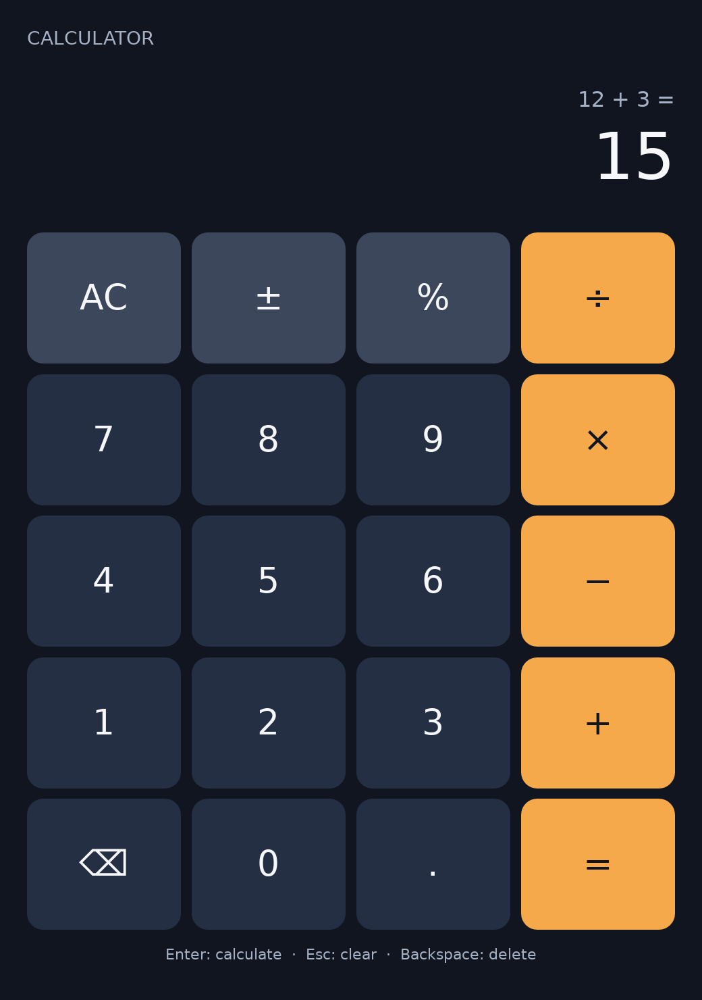

# Valdi calculator

A shared four-function calculator written with ordinary Valdi state, layout and
tap handlers. The `calculator` module contains the same calculation model and TSX
component for every host. It defaults to the platform system font and requires no
native component context. Hosts may optionally supply a font family, keyboard
input connection and state/layout observations.

The Linux launcher lives in `linux/main.cpp` and renders through `ValdiLayer`,
SnapDrawing and the optional SDL3 Linux window host.
SnapDrawing rasterizes on the CPU in this baseline; SDL owns window-surface
presentation. This example does not create a SnapDrawing GPU context.
It needs no application-specific shell, service framework or native view toolkit.

The calculation model supports digits, decimals, sign, percent, clear, backspace,
operator replacement, immediate-execution chaining and non-finite-result recovery.
This is a small integration example, not a scientific calculator. It never
evaluates an expression as JavaScript source.

## Web

Build the existing Valdi web application target and serve its extracted ZIP:

```sh
bazel build //apps/calculator:calculator_web
unzip -q bazel-bin/apps/calculator/calculator_web.zip -d /tmp/valdi-calculator-web
python3 -m http.server 8765 --bind 127.0.0.1 --directory /tmp/valdi-calculator-web
```

Open `http://127.0.0.1:8765` and use the calculator buttons. The generated entry
uses Valdi's `ValdiWebRenderer` with the same `CalculatorApp` component and an
empty context. This launcher supplies no keyboard bridge; desktop keyboard
shortcuts below belong to the Linux launcher. The native label font auto-fit
attribute is omitted on web because the current web renderer does not implement
it; long results may overflow at narrow widths.

The shared `:calculator` module and `:calculator_web` launcher intentionally stay
in wildcard builds; only the native SDL launchers are `manual`.

## Linux

### Build and run

Install SDL3 >= 3.2 development headers/libraries and pkg-config. See the
[host build notes](../../valdi_linux_window/README.md) for the experimental system
dependency binding and current source-build qualification limits.

```sh
bazel build //apps/calculator:calculator_linux \
  --//bzl/valdi:js_engine=quickjs \
  --//bzl/valdi:js_bytecode_format=quickjs
mkdir -p /tmp/valdi-calculator-modules
bazel-bin/apps/calculator/calculator_linux /tmp/valdi-calculator-modules /path/to/font.ttf
```

The host uses the runtime's configured default JavaScript engine. The command
above explicitly selects matching QuickJS runtime and module bytecode profiles;
the repository's engine default and bytecode default are separate settings.
For a prebuilt SDK, use its recorded engine/bytecode/compiler profile and
regenerate every module and static resource with the matched tools. Do not reuse
Hermes output with a QuickJS runtime, or the reverse. A matched Hermes source
build can select `hermes` for both flags instead.

Before the module rename, the original `linux_calculator` passed three full
runtime cycles on each of X11, Wayland 1× and Wayland 2× using a clean QuickJS
SDK cohort based on public runtime source
`53b70efda8c520037ecba12a7264b777d9e3f4fd` (SDK export recipe
`b37c808620d64a67a44f43823a824ea02a007f98`). This exposed and required the
Linux JSX bootstrap/class-mapping fix included in this change. Its corrected
`valdi_core` module was regenerated with the matched compiler/toolbox and a
source-restored companion in Bazel; the SDK engine archives remained unchanged.

That qualification compiled only the application/test sources and one generated
core-resource source, then ran with the module producer source/cache inaccessible.
It is an SDK-consumer qualification at the recorded source cohort, not a full
Bazel source build of the newer upstream engine. The copied SDK TypeScript tool
payload is not qualified for arbitrary compilation without its source context.

The Bazel target statically registers its compiled module resources, so its
extra module-search directory may be empty. Pass a real font file; it is
registered as the `Window` family rather than relying on platform font discovery.
Keyboard digits/operators, Enter, Escape and Backspace supplement button taps.
Keyboard commands use SDL key events; no text-input/IME or editing claim is made.

## Verification

The shared component was compiled with Valdi and exercised in Chrome on macOS:
addition, decimal addition, clear, backspace, sign/percent, division-by-zero,
recovery without clearing, operator replacement and chaining passed. Resizing
the browser to 420×640 and 320×640 preserved state and kept all 20 keys within
the viewport. The web entry supplied an empty component context.

This was a web smoke test, using a source-built compiler and locally adapted
Command Line Tools packaging setup. It does not qualify the default full native
Bazel toolchain, native macOS, or a rerun of the renamed Linux launcher.

The calculator model is compiled by `ts_project` and its seven Node tests are
gated through the existing `tools/ci/test_modules.sh` entry point in both CI
systems. Run the target directly from the repository root:

```sh
bazel test //apps/calculator:calculator_model_test --test_output=errors
```

For a manual run from this directory, compile the pure calculation model with
TypeScript 5.3.3 and pass its output path to the same Node tests:

```sh
model_output=$(mktemp -d)
npx --yes --package=typescript@5.3.3 tsc src/Calculator.ts \
  --outDir "$model_output" --target ES2020 --module commonjs --strict --skipLibCheck
node test/model.test.cjs "$model_output/Calculator.js"
rm -rf "$model_output"
```

The Linux executable accepts `--self-test [snapshot.bmp]` after the module/font
arguments. It waits for real component layout, injects SDL mouse events at the
reported key centers, verifies `12 + 3 = 15`, then exercises keyboard input,
clear/backspace, divide-by-zero recovery and resizing while preserving the
result. It creates/destroys the complete application three times and checks the
component's disconnect callback on teardown. The snapshot is the actual SDL
window surface after resizing, not a recreated UI or render mockup.

From the repository root, run the calculator on private Xvfb and headless Weston
displays, including 1× and 2× Wayland pixels:

```sh
bash valdi_linux_window/test/run-displays.sh \
  bazel-bin/apps/calculator/calculator_linux /tmp/calculator-results \
  /tmp/valdi-calculator-modules /path/to/font.ttf --self-test
```

See the host notes for compositor prerequisites. The test harness appends a
snapshot path for each display and cleans up its private display processes. The
tests do not measure performance,
prove physical GPU behavior, audit leaks, validate real IMEs, or establish a
desktop accessibility bridge.



This screenshot is the actual SDL surface from the clean QuickJS SDK consumer
with the Linux bootstrap fix, after resizing on a 2× headless Wayland output.
SDL presentation used Mesa softpipe; this is not physical GPU qualification.
