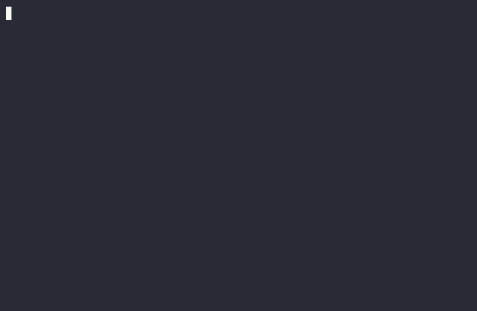

The `valdi_tui` module renders Valdi components to a terminal, in the spirit of
[Ink](https://github.com/vadimdemedes/ink) for React. Components are laid out with the
same flexbox engine that Valdi uses on device, measured in terminal cells, and painted
as ANSI text. Each state change redraws the previous frame in place.

A terminal application is a [CLI application](./workflow-cli-application.md): it is
built with `valdi_cli_application()` and runs under the standalone runtime. Pass
`terminal = True` to opt in:

```python
valdi_cli_application(
    name = "my_tui_app",
    script_path = "my_tui/index",
    terminal = True,
    deps = [":my_tui"],
)
```

`terminal = True` links the native terminal backend (`//valdi:valdi_terminal`), registers it
with the runtime, runs the JS runtime as macOS or Linux, and has the host take ownership of the
terminal while a `tty` root is on screen (raw mode, keyboard input, resize, Ctrl+C) and restore
it however the process ends. The platform the runtime reports (`getCurrentPlatform()`, and with
it the JSX platform) is macOS or Linux, but `Device.getSystemType()` still returns `ios` for every
standalone host; device identity for desktop command line applications is a follow-up. Linking the backend is not enough: without `terminal = True`
`render()` fails with "valdi_tui needs the native terminal backend". An application built
without it links no terminal code at all.

## Run the example

```sh
bazel run //apps/tui_example:tui_example_app
```



The recording is also available as an [asciicast](./assets/workflow-terminal-ui/demo.cast) for `asciinema play`.

Use the arrow keys to move, type a note and press Enter to log it, and Esc or Ctrl+C to
quit. Running the same binary with `--once` and stdout redirected to a file or pipe prints a
single frame and exits; without `--once` a redirected run keeps going, draws nothing until it
exits, and then prints its last frame. The example's tests (`tui_example_smoke_test` and `tui_example_pty_test`) run it
without and inside a pseudo terminal.

## Building blocks

| valdi_tui | Ink | Role |
|---|---|---|
| `<Box>` | `<Box>` | Flexbox container (a `<view>`) with optional border and background |
| `<Text>` | `<Text>` | Styled, wrapped text (a `<label>`) measured in cells |
| `<Newline>` | `<Newline>` | Vertical spacing |
| `<Spacer>` | `<Spacer>` | Flexible gap between siblings |
| `<Static>` | `<Static>` | Permanent output written above the live frame (a `ValdiTerminalStatic` view) |
| `<Transform>` | `<Transform>` | Post-processes the text of its value |
| `render()` | `render()` | Mounts the root component and returns an instance |
| `useInput()` | `useInput` | Keyboard input for the lifetime of a component |
| `useFocus()` | `useFocus` | Tab-cycled focus between components |
| `getTerminalApp()` | `useApp`, `useStdout` | Exit, terminal size, resize events |

### Boxes and text

`<Box>` accepts the usual Valdi flexbox attributes (`flexDirection`, `justifyContent`,
`alignItems`, `padding*`, `margin*`, `gap`, `width`, `height`, …) plus `borderStyle`
(`single`, `double`, `round`, `bold`, `singleDouble`, `doubleSingle`, `classic`, `arrow`),
`borderColor`, `borderDimColor`, per-side `borderTop`/`borderLeft`/… toggles and
`backgroundColor`. A border occupies one cell on each enabled side; it is part of the
box's layout, so it needs no extra padding. Like Ink, `flexDirection` defaults to `row`.

`render()` hosts the root component in a column container, so the root component can render
any element, including a lone `<Text>` or `<Static>`.

`<Text>` takes its content through `value`. A plain string wraps inside the available
width; an array of strings and spans styles parts of one paragraph:

```tsx
import { Component } from 'valdi_core/src/Component';
import { Box } from 'valdi_tui/src/Box';
import { Text } from 'valdi_tui/src/Text';

class Status extends Component<{ readonly ok: boolean }> {
  onRender(): void {
    <Box borderStyle='round' paddingX={1} flexDirection='column'>
      <Text bold value='Deploy' />
      <Text value={['Status: ', { text: this.viewModel.ok ? 'ok' : 'failed', color: this.viewModel.ok ? 'green' : 'red' }]} />
      <Text dimColor wrap='truncate' value='This line is cut with an ellipsis when the terminal is narrow.' />
    </Box>;
  }
}
```

Text style props are `color`, `backgroundColor`, `bold`, `italic`, `underline`,
`strikethrough`, `inverse` and `dimColor`. Colors accept Ink names (`green`,
`redBright`, `gray`), CSS names, `#rrggbb`, `rgb()` and `ansi256(n)`; they are resolved to
RGB values and downgraded to what the terminal supports. `wrap` is one of `wrap`,
`truncate`, `truncate-start` or `truncate-middle`.

`<Text>` is a `<label>`, so bold, dim and italic reach the backend through the label's
`font` (`system-bold 1`, `system-light 1`, `system-italic 1`; the traits combine, so
`bold` with `dimColor` is `system-bold-light 1` and prints SGR 1 and 2), underline and strikethrough
through `textDecoration`, and styled parts through attributed text. `inverse` applies to the
whole text, not to a single span.

Because text is a measured leaf node, nested `<Text>` components do not flow into one
paragraph. Use spans for inline styling, and a `<Box>` with `flexDirection='row'` for
side-by-side text.

### Rendering and exiting

```tsx
import { getStandaloneRuntime } from 'valdi_standalone/src/ValdiStandalone';
import { render } from 'valdi_tui/src/TerminalRenderer';

const instance = render(App, { title: 'Hello' });
void instance.waitUntilExit().then(() => getStandaloneRuntime().exit(0));
```

`render()` returns an instance with `rerender(viewModel)`, `unmount()`,
`waitUntilExit()`, `clear()` and, for tests, `lastFrame()`, `nextFrame()`, `feedInput()`,
`setSize()` and `output()`. The renderer keeps the runtime alive until `unmount()` is
called or a component calls `getTerminalApp().exit()`.

Raw mode turns the terminal's own Ctrl+C handling off, so the host handles the key. With the
default `exitOnCtrlC: true` it restores the terminal and exits the process with status 130
without waiting for JavaScript: the application is not unmounted and no final frame is painted.
If the process has not exited a second later, for example because the JS thread is stuck, the
host exits it anyway, and a second Ctrl+C exits immediately instead of waiting. With
`exitOnCtrlC: false` the byte is delivered to `useInput()` handlers as `ctrl` + `c`, and the
application decides what to do. SIGINT, SIGTERM, SIGHUP, SIGQUIT and SIGPIPE, and crashes,
restore the terminal (modes, colors and cursor) before the process dies. Raw mode is entered only
when both stdin and stdout are terminals, so a redirected stdout never leaves the shell without
echo.

By default the root is as tall as its content, like Ink. Pass `fitTerminal: true` to size
it to the terminal instead, for full-screen layouts that use `flexGrow` to fill the
viewport.

While the application runs, `console.log` and friends are redirected above the live
frame so they do not corrupt it (`patchConsole: false` disables this).

### Input and focus

Keyboard handlers follow the class component model. Register them in `onCreate()`; the
subscription is disposed with the component:

```tsx
import { StatefulComponent } from 'valdi_core/src/Component';
import { getTerminalApp, useFocus, useInput } from 'valdi_tui/src/App';
import { Text } from 'valdi_tui/src/Text';

class Menu extends StatefulComponent<{}, { readonly index: number }> {
  state = { index: 0 };
  private focus = useFocus(this, { autoFocus: true });

  onCreate(): void {
    useInput(this, (input, key) => {
      if (key.downArrow) {
        this.setState({ index: this.state.index + 1 });
      } else if (input === 'q') {
        getTerminalApp().exit();
      }
    });
  }

  onRender(): void {
    <Text inverse={this.focus.isFocused} value={`Item ${this.state.index}`} />;
  }
}
```

The `key` object has the same flags as Ink's (`upArrow`, `return`, `escape`, `ctrl`,
`meta`, `shift`, `tab`, `backspace`, `delete`, `pageUp`, `pageDown`, `home`, `end`).
Tab and Shift+Tab move focus between components registered with `useFocus()`;
`getTerminalApp().focus` exposes `focusNext()`, `focusPrevious()`, `focus(id)` and
`disableFocus()`.

### Static output

`<Static>` renders a list of items once, above the live frame, and never erases them.
Use it for logs and completed work. It is positioned absolutely, so it takes no rows from
the live frame:

```tsx
class Log extends StatefulComponent<{}, { readonly entries: ReadonlyArray<LogEntry> }> {
  state = { entries: [] };

  onRender(): void {
    <Static items={this.state.entries} render={this.renderEntry} />;
  }

  private readonly renderEntry = (entry: LogEntry): void => {
    <Text dimColor value={entry.text} />;
  };
}
```

What has been written is tracked by item index, as in Ink: when the list grows, only the items
after the ones already emitted are written. Keep the list append-only; changing or reordering
earlier items does not rewrite them.

## Testing

Passing `sink: 'memory'` renders into an in-memory terminal that records everything it is
asked to write, instead of the process terminal. Combined with `nextFrame()` and
`feedInput()`, components can be tested inside a regular Valdi module test:

```tsx
import { render } from 'valdi_tui/src/TerminalRenderer';

const instance = render(Counter, {}, { sink: 'memory', columns: 40, rows: 10 });
expect(await instance.nextFrame()).toEqual(['count: 0']);
instance.feedInput('\x1b[A');
expect(await instance.nextFrame()).toEqual(['count: 1']);
instance.unmount();
```

The first frame after `render()` is already laid out. Later frames can be painted before a
change has finished laying out, so tests that care about a particular frame should keep calling
`nextFrame()` until the expected one arrives. `nextFrame()` rejects once the instance is
unmounted, and a pending one resolves with the last frame at `unmount()`. Other options for the memory sink: `isTTY: false` writes the output once at `unmount()` like a
redirected stdout, `colorLevel` selects how many colors the recorded output uses, `output()`
returns everything written, and `setSize(columns, rows)` resizes the terminal.

The module test runner (`valdi_standalone`) registers the terminal backend, so
`bazel test` on a module that uses `valdi_tui` works without extra setup.

## How it works

`render()` asks the native terminal backend for a root with `createRoot()`. The root owns a
Valdi context whose view manager is the terminal view manager, and `render()` mounts the
component tree into that context with the normal renderer, so components go through the same
pipeline as on device:

- `<Box>` is a `<view>` and `<Text>` is a `<label>`. Their attributes are bound by the
  terminal view classes (`SCValdiView`, `SCValdiLabel`, `ValdiTerminalStatic`). The border and
  text-wrap attributes are not part of the `<view>` and `<label>` typings, so the components
  emit them through `<custom-view>` with the same classes.
- Yoga computes the layout in cells. Labels measure themselves natively, wrapping and
  truncating text at the available width with East Asian width and emoji clusters taken into
  account, so no measure callback runs in JavaScript.
- The backend paints the laid-out tree into a grid of cells, serializes it to ANSI at the
  sink's color level, and writes it through a frame writer that redraws the previous frame in
  place. Frames are coalesced to one per turn of the main thread.
- `observeFrame()` delivers each painted frame to JavaScript; `lastFrame()` and `nextFrame()`
  are built on it. Frames carry an increasing `sequence`, and an older frame never replaces a
  newer one. Frames are painted on the main thread and handed to the JavaScript queue, except
  the last frame at `unmount()`, which is painted and delivered on the JavaScript thread. `writeAbove()` queues lines that are written above the live frame, which is
  how `console.log` is redirected, and `finishRoot()` paints the last frame and leaves the
  output consistent when the application unmounts.
- Input is carried by the same bridge. `feedInput()` delivers text to the observers registered
  with `observeInput()` for the same root, which parse it into key presses and dispatch them to
  `useInput()` handlers. Input and resize observers belong to one root, so several renders in
  one process do not see each other's keys. `getTerminalApp()` returns the newest mounted
  application, and unmounting restores the one before it.
- For `tty` roots in an application built with `terminal = True`, a host (`TerminalHost`) reads the
  real keyboard: `render()` asks it for raw mode when stdin is a terminal, and a reader thread
  delivers the input, whole UTF-8 sequences at a time, to the same observers. A `SIGWINCH` handler
  wakes the reader, which lays the live roots out for the new size on the main thread and notifies
  `useResize()` handlers; roots created with explicit `columns` or `rows` keep their size. The module
  test runner registers the backend without a host, so specs only use the memory sink.

The bridge module is `valdi_tui/src/TerminalBackendBridge`; its declarations live in
`TerminalBackendBridge.d.ts` and `TerminalBackend.ts` wraps it.

Limitations: no mouse support, no alternate screen, nested `<Text>` does not flow inline,
named colors are fixed RGB values (a 16-color terminal gets the nearest match rather than
its own palette entry), and Windows is not supported.
