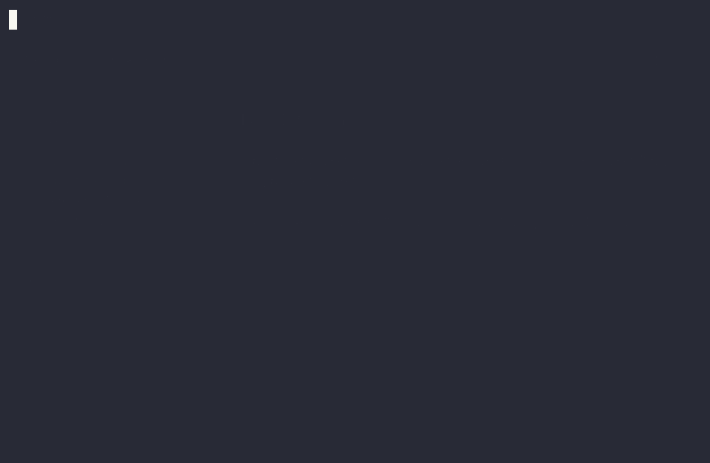

The `valdi_tui` module renders Valdi components to a terminal, in the spirit of
[Ink](https://github.com/vadimdemedes/ink) for React. Components are laid out with the
same flexbox engine that Valdi uses on device, measured in terminal cells, and painted
as ANSI text. Each state change redraws the previous frame in place.

A terminal application is a [CLI application](./workflow-cli-application.md): it is
built with `valdi_cli_application()` and runs under the standalone runtime.

## Run the example

```sh
bazel run //apps/tui_example:tui_example_app
```



The recording is also available as an [asciicast](./assets/workflow-terminal-ui/demo.cast) for `asciinema play`.

Use the arrow keys to move, type a note and press Enter to log it, and Esc to quit.
Running the same binary with stdout redirected to a file or pipe prints a single frame
and exits.

## Building blocks

| valdi_tui | Ink | Role |
|---|---|---|
| `<Box>` | `<Box>` | Flexbox container with optional border and background |
| `<Text>` | `<Text>` | Styled, wrapped text measured in cells |
| `<Newline>` | `<Newline>` | Vertical spacing |
| `<Spacer>` | `<Spacer>` | Flexible gap between siblings |
| `<Static>` | `<Static>` | Permanent output written above the live frame |
| `<Transform>` | `<Transform>` | Post-processes the rendered lines of its children |
| `render()` | `render()` | Mounts the root component and returns an instance |
| `useInput()` | `useInput` | Keyboard input for the lifetime of a component |
| `useFocus()` | `useFocus` | Tab-cycled focus between components |
| `getTerminalApp()` | `useApp`, `useStdout` | Exit, terminal size, resize events |

### Boxes and text

`<Box>` accepts the usual Valdi flexbox attributes (`flexDirection`, `justifyContent`,
`alignItems`, `padding*`, `margin*`, `gap`, `width`, `height`, …) plus `borderStyle`
(`single`, `double`, `round`, `bold`, `singleDouble`, `doubleSingle`, `classic`, `arrow`
or a custom character set), `borderColor`, per-side `borderTop`/`borderLeft`/… toggles and
`backgroundColor`. A border occupies one cell on each enabled side.

`<Text>` takes its content through `value`. A plain string wraps inside the available
width; an array of strings and spans styles parts of one paragraph:

```tsx
import { Component } from 'valdi_core/src/Component';
import { Box } from 'valdi_tui/src/Box';
import { Text } from 'valdi_tui/src/Text';

class Status extends Component<{ readonly ok: boolean }> {
  onRender(): void {
    <Box borderStyle='round' paddingX={1} flexDirection='column'>
      <Text bold value='Deploy' />
      <Text value={['Status: ', { text: this.viewModel.ok ? 'ok' : 'failed', color: this.viewModel.ok ? 'green' : 'red' }]} />
      <Text dimColor wrap='truncate' value='This line is cut with an ellipsis when the terminal is narrow.' />
    </Box>;
  }
}
```

Text style props are `color`, `backgroundColor`, `bold`, `italic`, `underline`,
`strikethrough`, `inverse` and `dimColor`. Colors accept Ink names (`green`,
`redBright`, `gray`), CSS names, `#rrggbb`, `rgb()` and `ansi256(n)`. They are downgraded
to what the terminal supports (`COLORTERM`, `TERM`, `NO_COLOR` and `FORCE_COLOR` are
honored). `wrap` is one of `wrap`, `truncate`, `truncate-start` or `truncate-middle`.

Because text is a measured leaf node, nested `<Text>` components do not flow into one
paragraph. Use spans for inline styling, and a `<Box>` with `flexDirection='row'` for
side-by-side text.

### Rendering and exiting

```tsx
import { getStandaloneRuntime } from 'valdi_standalone/src/ValdiStandalone';
import { render } from 'valdi_tui/src/TerminalRenderer';

const instance = render(App, { title: 'Hello' });
void instance.waitUntilExit().then(() => getStandaloneRuntime().exit(0));
```

`render()` returns an instance with `rerender(viewModel)`, `unmount()`,
`waitUntilExit()`, `clear()` and, for tests, `lastFrame()` and `nextFrame()`. The
renderer keeps the runtime alive until `unmount()` is called or a component calls
`getTerminalApp().exit()`. Ctrl+C unmounts as well unless `exitOnCtrlC: false` is passed.

By default the root is as tall as its content, like Ink. Pass `fitTerminal: true` to size
it to the terminal instead, for full-screen layouts that use `flexGrow` to fill the
viewport.

While the application runs, `console.log` and friends are redirected above the live
frame so they do not corrupt it (`patchConsole: false` disables this).

### Input and focus

Keyboard handlers follow the class component model. Register them in `onCreate()`; the
subscription is disposed with the component:

```tsx
import { StatefulComponent } from 'valdi_core/src/Component';
import { getTerminalApp, useFocus, useInput } from 'valdi_tui/src/App';

class Menu extends StatefulComponent<{}, { readonly index: number }> {
  state = { index: 0 };
  private focus = useFocus(this, { autoFocus: true });

  onCreate(): void {
    useInput(this, (input, key) => {
      if (key.downArrow) {
        this.setState({ index: this.state.index + 1 });
      } else if (input === 'q') {
        getTerminalApp().exit();
      }
    });
  }

  onRender(): void {
    <Text inverse={this.focus.isFocused} value={`Item ${this.state.index}`} />;
  }
}
```

The `key` object has the same flags as Ink's (`upArrow`, `return`, `escape`, `ctrl`,
`meta`, `shift`, `tab`, `backspace`, `delete`, `pageUp`, `pageDown`, `home`, `end`).
Tab and Shift+Tab move focus between components registered with `useFocus()`;
`getTerminalApp().focus` exposes `focusNext()`, `focusPrevious()`, `focus(id)` and
`disableFocus()`.

### Static output

`<Static>` renders a list of items once, above the live frame, and never erases them.
Use it for logs and completed work:

```tsx
<Static items={this.state.log} render={(entry: LogEntry) => <Text dimColor value={entry.text} />} />
```

Only lines that have not been written yet are emitted when the list grows.

## Testing

`MemoryTerminal` stands in for the real terminal and records everything written to it.
Combined with `nextFrame()` and `sendInput()`, components can be tested inside a regular
Valdi module test:

```tsx
import { MemoryTerminal } from 'valdi_tui/src/Terminal';
import { render } from 'valdi_tui/src/TerminalRenderer';

const terminal = new MemoryTerminal({ columns: 40, rows: 10 });
const instance = render(Counter, {}, { terminal });
expect(await instance.nextFrame()).toEqual(['count: 0']);
terminal.sendInput('\x1b[A');
expect(await instance.nextFrame()).toEqual(['count: 1']);
instance.unmount();
```

## How it works

Components render through the normal native pipeline of the standalone runtime: Yoga
computes the layout, `<Text>` measures itself with an `onMeasure` callback that wraps the
text at the available width, and the renderer reads the laid-out tree back with
`getRenderedElement()`. A painter turns frames into a grid of cells, which is serialized
to ANSI once per frame. Keyboard input, raw mode, terminal size and resize notifications
come from the runtime's terminal bridge (`valdi_standalone/src/TerminalBridge`), which is
a native module of the standalone runtime. Set `VALDI_TUI_DEBUG=1` to log the measured
size and the rendered tree of every frame to stderr.

Limitations: no mouse support, no alternate screen, nested `<Text>` does not flow inline,
and Windows is not supported.
